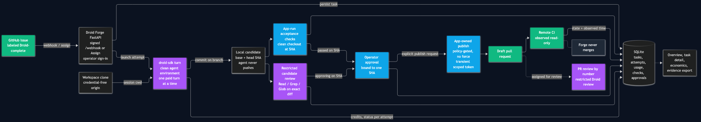

# Droid Forge — The AI Engineer That Delivers

A production-ready automation service that turns **GitHub Issues into reviewed local change candidates** using the official [Factory Droid SDK](https://docs.factory.ai/sdk/python) (`droid-sdk`) running local [Droid](https://docs.factory.ai/droid-cli/overview) sessions. Label an issue, and the system dispatches a Droid agent to implement the fix, run the tests and commit on a branch, records that commit as a candidate, and can review pull requests with a second, read-only Droid agent — with full lifecycle tracking, metrics, and an operations dashboard. Agent success never pushes, opens a pull request or merges anything.

> Previously "Cursor Forge": this service used Cursor Cloud Agents. It has been fully refactored onto Factory's Droid: every Cursor SDK call is now a `droid-sdk` call running where the app runs.

---

## Project Overview

When a GitHub Issue is labeled `Droid-complete` in a configured repository (e.g. your fork of [`apache/fineract`](https://github.com/apache/fineract)), this service:

1. Receives the webhook and validates its HMAC signature.
2. Persists a **Task** record in SQLite.
3. Launches a **local Droid session** via the Python SDK (`droid-sdk`) inside a fresh clone of the target repo. The clone's `origin` is credential-free, so the agent cannot push; an optional per-repo **setup command** (e.g. `npm ci`) runs only when privileged setup is enabled.
4. Streams the agent turn in a background asyncio task; Droid makes the requested changes, runs the project's tests, fixes failures, commits on a new branch, and reports `BRANCH: <name>` plus a summary.
5. On completion, forge records the **local candidate** (base SHA, candidate commit SHA, branch, and whether the tree was clean), stores the summary, runtime, tokens and Factory credits, and, only when GitHub writes are enabled, posts a ✅ comment on the issue saying nothing was pushed. Publishing is a separate, later step (`app/publishing.py`) that no automatic path calls; see [Delivery](#delivery).
6. A **second Droid session** reviews a pull request assigned for review. It is restricted to the `Read`, `Grep` and `Glob` tools and sees the exact base-to-head diff; forge stores its structured verdict and findings and posts them as a **GitHub PR review** pinned to the reviewed commit.
7. Exposes a live **dashboard**, a **metrics endpoint**, an orchestration-grade **health endpoint**, and a **follow-up** API (`POST /api/tasks/{id}/follow-up`) for SDK `Session.resume` + stream.

**Two equivalent triggers**

1. **GitHub label** — apply `Droid-complete` on an issue. GitHub POSTs to `PUBLIC_BASE_URL/webhook` (tunnel required) and forge launches the session.
2. **Dashboard Assign** — **Add Issues** imports 5 open issues; **Assign to Droid** applies the same `Droid-complete` label on GitHub (so flow 1 can fire) and launches the session directly when `PUBLIC_BASE_URL` is unset (duplicates are ignored).

## Architecture

Droid sessions run **locally, next to the forge app** — in your venv, your laptop, or the Docker container — each inside its own workspace clone. The app is event-driven: session turns finish in background asyncio tasks and update the database immediately, while a worker loop reconciles GitHub-side PR/merge state.

```mermaid
flowchart LR
    ISSUE["GitHub Issue<br/>labeled Droid-complete"]
    WEB["Droid Forge FastAPI<br/>signed /webhook or Assign<br/>operator sign-in"]
    DB[("SQLite<br/>tasks, attempts, usage,<br/>checks, approvals")]
    WS["Workspace clone<br/>credential-free origin"]
    SDK["droid-sdk turn<br/>clean agent environment<br/>one paid turn at a time"]
    CAND["Local candidate<br/>base + head SHA<br/>agent never pushes"]
    CHECKS["App-run acceptance checks<br/>clean checkout at SHA"]
    CREV["Restricted candidate review<br/>Read / Grep / Glob on exact diff"]
    APPROVE["Operator approval<br/>bound to one SHA"]
    PUSH["App-owned publish<br/>policy-gated, no force<br/>transient scoped token"]
    PR["Draft pull request"]
    CI["Remote CI<br/>observed read-only"]
    PRREV["PR review by number<br/>restricted Droid review"]
    UI["Overview, task detail,<br/>economics, evidence export"]

    ISSUE -->|"webhook / assign"| WEB
    WEB -->|"persist task"| DB
    WEB -->|"launch attempt"| SDK
    WS -->|"session cwd"| SDK
    SDK -->|"commit on branch"| CAND
    CAND --> CHECKS
    CAND --> CREV
    CHECKS -->|"passed on SHA"| APPROVE
    CREV -->|"approving on SHA"| APPROVE
    APPROVE -->|"explicit publish request"| PUSH
    PUSH --> PR
    PR --> CI
    PR -.->|"assigned for review"| PRREV
    SDK -->|"credits, status per attempt"| DB
    CHECKS --> DB
    CREV --> DB
    APPROVE --> DB
    CI -->|"state + observed time"| DB
    DB -.-> UI

    NOMERGE["Forge never merges"]
    CI -.- NOMERGE

    classDef droid fill:#a855f7,stroke:#6b21a8,color:#fff
    classDef gh fill:#10b981,stroke:#047857,color:#fff
    classDef gate fill:#0ea5e9,stroke:#0369a1,color:#fff
    classDef note fill:#1f2937,stroke:#6b7280,color:#e5e7eb
    class SDK,CREV,PRREV droid
    class PR,CI,ISSUE gh
    class CHECKS,APPROVE,PUSH gate
    class NOMERGE note
```





The PNG and the block above render the same source, [`docs/architecture.mmd`](docs/architecture.mmd).
Keep them in sync; to regenerate the PNG:

```bash
npx -p @mermaid-js/mermaid-cli mmdc \
  -i docs/architecture.mmd \
  -o docs/architecture.png \
  -t dark -b "#0b1220" --size 1800 -s 1
```

## Technology Stack

| Layer | Technology |
|---|---|
| Language | Python 3.12+ |
| Web framework | FastAPI + Uvicorn |
| Persistence | SQLite + SQLAlchemy 2.x |
| Agent runtime | Official Python [Droid SDK](https://docs.factory.ai/sdk/python) (`droid-sdk`) → local Droid sessions |
| Background work | Per-run asyncio tasks (event-driven) + GitHub state poller |
| HTTP client | httpx (async) for GitHub; `droid-sdk` for Droid |
| Config | pydantic-settings + python-dotenv |
| UI | Jinja2 + Bootstrap 5 |
| Container | Docker + Docker Compose |
| Tests | pytest + respx |

---

## Clone and replicate this setup

Follow these steps on any machine (macOS/Linux) to run the same stack end-to-end.

### Prerequisites

| Tool | Why |
|---|---|
| [Git](https://git-scm.com/) | Workspace clones + agent pushes |
| [Python 3.12+](https://www.python.org/downloads/) | Runtime |
| [Droid CLI](https://docs.factory.ai/droid-cli/quickstart) | The SDK drives `droid` as a subprocess (`curl -fsSL https://app.factory.ai/cli \| sh`, Homebrew, or npm) |
| [Docker Desktop](https://www.docker.com/products/docker-desktop/) *(optional)* | One-command container run |
| [GitHub CLI `gh`](https://cli.github.com/) *(recommended)* | Create webhooks / test issues |
| [ngrok](https://ngrok.com/) or [cloudflared](https://developers.cloudflare.com/cloudflare-one/connections/connect-apps/) | Expose `localhost:8000` so GitHub can reach `/webhook` |

You will also need:

1. A **GitHub personal access token** with permission to read repos, write issues/comments/labels, open PRs, and post PR reviews on the target repository.
2. A **Factory API key** from [Factory Settings → API Keys](https://app.factory.ai/settings/api-keys) (optional when the local `droid` CLI is already authenticated; required inside Docker).
3. A **webhook secret** string of your choosing (any long random value).

### 1. Clone the repository

```bash
git clone https://github.com/jan21deepak/cursor_ai_engineer.git
cd cursor_ai_engineer
```

### 2. Configure environment variables

```bash
cp .env.example .env
```

Edit `.env` and fill in at least:

```bash
GITHUB_WEBHOOK_SECRET=some-long-random-secret
GITHUB_TOKEN=<your-github-pat>
FACTORY_API_KEY=<your-factory-api-key>
TRIGGER_LABEL=Droid-complete
FORGE_ACCESS_MODE=protected
FORGE_OPERATOR_TOKEN=<at-least-32-random-characters>
FORGE_ALLOWED_REPOSITORIES=<owner>/<repo>
FORGE_ALLOWED_BRANCHES=<branch-the-app-may-publish>
FORGE_ALLOW_GITHUB_WRITES=false   # set true only when GitHub writes are approved
FORGE_ALLOW_PRIVILEGED_SETUP=false
```

Generate the operator token locally and keep it out of commits, logs and
screenshots, e.g. `python3 -c 'import secrets; print(secrets.token_urlsafe(36))'`.
See [Operator access](#operator-access) for the full access model.

Optional: `DROID_MODEL` (default `auto` = Factory Router), `DROID_AUTONOMY` (default `high`, fix sessions; reviews always use the restricted tool set), `DROID_USD_PER_AGENT_RUN` for the legacy assumption-based `/metrics` estimate, `DROID_TURN_TIMEOUT_SECONDS` (default 3600) for the per-turn wall-clock budget.

Verify the Droid key (the SDK uses the same key):

```bash
.venv/bin/python - <<'PY'
import asyncio, os
from droid_sdk import list_models

async def main():
    models = await list_models(api_key=os.environ["FACTORY_API_KEY"])
    print([m.id for m in models][:5])

asyncio.run(main())
PY
```

### 3. Run the service

**Option A — Local Python (sessions run on this machine)**

```bash
python3 -m venv .venv
source .venv/bin/activate          # Windows: .venv\Scripts\activate
pip install -r requirements.txt

mkdir -p data
.venv/bin/uvicorn app.app:app --host 127.0.0.1 --port 8000 --no-proxy-headers
```

**Option B — Docker (recommended for a clean replicate)**

```bash
docker compose up --build
```

This starts FastAPI on **http://localhost:8000**, initializes SQLite at `/data/tasks.db`, and keeps Droid sessions + workspace clones in the `droid_data` / `droid_home` volumes so runs survive restarts.

In another terminal (with the venv activated):

```bash
pytest -q
```

> Sessions run where the app runs. Your machine (or the container) must stay up for the duration of an agent run; a service restart marks in-flight runs `interrupted` and never resumes them on its own (see "Restart recovery").

### 4. Verify the app is healthy

```bash
curl -s http://localhost:8000/health                       # public liveness
open http://localhost:8000/dashboard                       # redirects to /login; sign in with the operator token
# API clients authenticate with the bearer header (never put the token in a URL):
curl -s -H "Authorization: Bearer $FORGE_OPERATOR_TOKEN" http://localhost:8000/api/health | python3 -m json.tool
```

`/health` returns only `{"status": "ok", "checks": {"database": "ok"}}`. The operator-only
`/api/health` adds GitHub/Droid connectivity; if `github` or `droid` show as
unreachable/unconfigured, the app still serves traffic (`degraded`) — fix the tokens in `.env` and restart.

### 5. Expose a public webhook URL (label-trigger flow)

GitHub cannot call `localhost`. Tunnel it:

```bash
# ngrok
ngrok http 8000
# → copy the https://….ngrok-free.app URL

# or cloudflared
cloudflared tunnel --url http://localhost:8000
```

Set `PUBLIC_BASE_URL` in `.env` to the tunnel URL and restart, then add the issues webhook in the repository's GitHub settings (payload URL `<PUBLIC_BASE_URL>/webhook`, content type JSON, secret `GITHUB_WEBHOOK_SECRET`). Forge does not install webhooks itself; `POST /api/webhooks/sync` is refused by policy.

The **Dashboard Assign** flow also works without a tunnel: it labels the issue on GitHub when `FORGE_ALLOW_GITHUB_WRITES=true` and launches the session directly.

### 6. Register the repo in the dashboard and trigger Droid

1. Open **http://localhost:8000/dashboard** → **Repositories** tab.
2. Paste `https://github.com/<owner>/<repo>` and click **Add repository**.
3. Optionally set a per-repo **model** and **setup command** (e.g. `npm ci`) on the row, then **Save**. A setup command is only stored: it runs before sessions only when `FORGE_ALLOW_PRIVILEGED_SETUP=true`, and the row says so while it is disabled.
4. Click **Add Issues** (imports open issues from the fork's parent when applicable) or **Sync**.
5. On the **Issues** tab, select issues → **Assign to Droid**.

**Or trigger via the webhook label:**

```bash
# Create the label once
gh label create Droid-complete --repo <owner>/<repo> \
  --color 0E8A16 --description "Trigger Droid Forge automation" || true

# Open / label an issue
gh issue create --repo <owner>/<repo> \
  --title "Fix: example bug" \
  --body "Describe the change." \
  --label Droid-complete
```

### 7. Watch the result

- **Dashboard** tab: fix + review stats, engineering KPIs, daily activity chart (times in **SGT**).
- Original GitHub issue: ✅ completion comment with session id, PR URL, runtime, summary.
- Droid commits on a branch and forge records it as a local candidate; nothing is pushed and no PR is opened automatically. A review session on an assigned PR posts a **PR review**; merge state is observed from GitHub but never changed.
- Follow-ups: `POST /api/tasks/{id}/follow-up` resumes the same Droid session as a new attempt (409 while the task has an active attempt or the session is streaming).
- Attempts: `GET /api/tasks/{id}` and `GET /api/reviews/{id}` return the row, its ordered attempts and usage coverage; see "Run attempts".

---

## How It Works

### GitHub Webhook Flow

1. GitHub delivers an `issues` event to `POST /webhook`. This route does not use operator login or bearer credentials; its only authentication is the webhook HMAC.
2. Without `GITHUB_WEBHOOK_SECRET` intake is disabled (**503**). The service verifies `X-Hub-Signature-256` with the shared secret (constant-time HMAC compare). Missing/invalid → **401**; malformed JSON or issue payload → **422**. `issue.number` must be a positive JSON integer as sent (booleans, fractions, strings, zero and negatives are rejected, never coerced).
3. Non-issue events are acknowledged and ignored (**200**).
4. The repository must be both registered in Forge and listed in `FORGE_ALLOWED_REPOSITORIES` → otherwise **403**, and no task is created.
5. Trigger rule: issue `opened` with the `Droid-complete` label, or the label being added (`labeled`). Anything else is ignored.
6. Duplicate protection: an active or completed task for the same repo + issue is not recreated. Every accepted `X-GitHub-Delivery` id gets a unique receipt row (`webhook_deliveries`) committed with its task before launch, including deliveries accepted as duplicates of an existing task. Redelivering that id never runs again, even after the task failed or the service restarted. A different delivery (for example, re-adding the label) or a dashboard assignment can still retry a failed issue.
7. A `Task` row is written to SQLite and the launch is fired in a background asyncio task (**202** — the response returns fast because GitHub kills webhook deliveries after ~10 seconds; workspace clones take longer).

### Droid Session Workflow

Each fix run:

1. **Workspace**: shallow clone of the target repo into `WORKSPACE_ROOT/<owner>/<repo>/task-<id>` with the credential-free `https://github.com/<owner>/<repo>.git` as `origin`. The service account's configured Git identity (`user.name`/`user.email`, or the `GIT_AUTHOR_*`/`GIT_COMMITTER_*` variables) is used unchanged and is required: if either is missing or blank the run fails before setup or any session, and Forge writes no identity of its own. The optional per-repo setup command runs only with `FORGE_ALLOW_PRIVILEGED_SETUP=true`.
2. **Session**: `Session(cwd=<workspace>, model=<per-repo or DROID_MODEL>, config=SessionConfig(autonomy=HIGH, auto_reject_permission_requests=True))`, opened via the SDK on a clean-environment `droid` process (see [Execution boundary](#execution-boundary)) and streamed in a background task.
3. **Turn**: the prompt includes the issue title/body and requires only the requested changes, running the test suite, committing on a new branch, *not* pushing or opening a PR, and ending with `BRANCH: <name>`.
4. **Completion**: `RunResult` gives success/failure, text summary, `duration`, token usage and `factory_credits`; forge persists all of it (credentials redacted) and inspects the workspace with app-owned Git to record the candidate: `base_sha` (the starting commit), `candidate_sha`, `candidate_branch` and `candidate_status` (`ready`, `dirty`, `no_changes` or `unavailable`). The task API exposes these under `candidate`. Success does not push, open a PR, start a review or grant publication approval.

Failure mapping: `RunSuccess` → completed; `RunInterrupted` / `RunFailure` / timeout → failed (with the SDK error stored on the task).

### PR Review

Each review is a fresh SDK session (never a resumed one) built from an exact, app-prepared context:

- **Actual base.** The base is the pull request's own `base.ref` as reported by GitHub. If the lookup fails or the value is missing, blank or not a plain branch name, the review fails before any workspace or session work; forge never substitutes the repository's configured starting ref, its default branch or `main`.
- **Context.** Forge makes a blobless full clone, fetches `pull/N/head`, checks out the head SHA detached, runs `git clean -ffdx`, refreshes the PR's base branch from `origin` (a failed refresh makes the context incomplete rather than reusing a stale ref), and computes the merge base and the complete `base..head` diff. The base SHA, head SHA, whether the diff was complete, and the review policy are stored on the review row.
- **One session per review row.** Assigning a PR that already has an active review is refused (`review_already_active`); a completed or failed review is reassigned into a fresh row with its own workspace, context and session. The session id is stored before the review turn starts, and the completion callback carries the exact context it was started over. A callback from another session, for a different base/head/policy, or for a row that is already finished is ignored: it changes nothing and makes no GitHub call.
- **Incomplete diffs.** A missing base, missing head, empty diff or diff above `REVIEW_DIFF_MAX_CHARS` in `app/review_policy.py` (150,000 characters) is never truncated: the review is marked failed before any session starts.
- **Restricted tools.** `SessionConfig(restrict_tools=["Read", "Grep", "Glob"], disable_builtin_skills=True, auto_reject_permission_requests=True)`, with no extra enabled or disabled tool lists. The reviewer cannot run commands, edit files or use Git; tests remain the app's job.
- **Verdict.** The prompt embeds the diff and asks for a JSON findings block plus a `VERDICT: APPROVE | REQUEST_CHANGES` line. Malformed or conflicting output is `INCONCLUSIVE`. An approval counts only for a restricted review of a complete diff with a recorded head SHA, and only if GitHub still reports that head; otherwise forge posts a plain comment. Reviews are posted with `commit_id` pinned to the reviewed SHA. If GitHub rejects the verdict event (e.g. the token owner opened the PR), forge falls back to a comment. Repository and write policy are rechecked before the head lookup as well as before posting, so a review outside the current policy keeps its sanitized local verdict and makes no GitHub call. Every posted body (verdict or comment fallback) is redacted before it is cut to the length limit.
- **No merging.** Forge has no merge or auto-merge code path. The poller only records that a PR was merged by someone else (`review.pr_merged_observed`); legacy `REVIEW_AUTO_MERGE` and `DROID_REVIEW_AUTONOMY` settings are ignored.

### Run attempts

Every Droid turn Forge starts is a `run_attempts` row linked to its parent task or review: `fix`, `follow_up`, `recovery` or `review`, numbered by `sequence`. The attempt is committed as `starting` before the SDK turn is spawned, and a parent can have only one active (`starting`/`running`) attempt, enforced by a partial unique index as well as the code, so a repeated start or follow-up gets **409** instead of a second turn. Each attempt records its own lifecycle timestamps, status (`completed`, `failed`, `interrupted`, `stopped`, `blocked`), session id, requested and SDK-reported model, base/head SHA, summary, error and usage categories (`input_tokens`, `output_tokens`, `cache_read_tokens`, `cache_creation_tokens`, `thinking_tokens`, `factory_credits`). Facts that were never observed are `null`, never zero.

A completion callback is bound to its attempt id. Only an attempt that is still active can be finalized, so a duplicate or late callback creates no attempt, overwrites nothing and counts no usage twice. Follow-ups and recoveries append a new attempt in the same session; earlier attempts keep their outcome, head SHA and usage, and a tracked task's usage columns are the sum of its attempts. `Session.resume` takes no model, so a resumed session keeps the model it was saved with unless the repository has a selected model (its `droid_model`): that value is read once when the continuation is admitted, recorded as the attempt's `requested_model`, and applied with `update_settings(model=...)` after the session opens and before the turn is sent. Without a selection the saved model is kept and `requested_model` stays `null`; the global `DROID_MODEL` is not substituted. If the model cannot be applied, nothing is sent, the session is closed and the attempt fails as `start_failed`, with no automatic retry or fallback. Evidence recorded for an earlier candidate SHA does not cover a newer candidate (`evidence_applies_to_candidate` in `app/candidates.py`). An attempt's agent success is not acceptance, publication, passing CI or a merge.

| Route | Purpose |
|---|---|
| `GET /api/tasks/{id}` | Task, ordered attempts and `accounting` (attempt credits, per-category totals, status/kind counts, legacy summary, coverage, dollars) |
| `GET /api/tasks/{id}/attempts` | Ordered attempts only |
| `GET /api/tasks/{id}/timeline` | Every attempt's operational events, in attempt then event order |
| `GET /api/reviews/{id}` | Review, its attempt(s) and accounting |
| `GET /api/attempts/{id}` | One attempt with its usage, dollar status and operational events |
| `POST /api/attempts/{id}/cost-estimate` | Record an explicit estimate: `{"rate_usd_per_credit": …, "source": "…"}` |
| `POST /api/attempts/{id}/cost-reconciliation` | Record a manually reconciled amount: `{"usd": …, "source": "…"}` |
| `POST /api/tasks/{id}/follow-up` | New `follow_up` attempt in the task's session |
| `POST /api/tasks/{id}/recover` | New `recovery` attempt for an interrupted or failed task (refused for completed tasks) |
| `POST /api/tasks/{id}/stop` | Durably stop the task's active attempt, then interrupt its live session |
| `POST /api/reviews/{id}/stop` | The same for a review |
| `GET /api/run-limits` | In-flight runs, configured limits and the spending check's current state |

All of them sit behind operator access. Continuations re-check repository policy before anything starts; a turn that cannot start closes its attempt as `failed` (usage unknown) and puts the task back in its previous status.

#### Stopping and run limits

- **Stop.** The stop route records `stop_requested_at` and `stop_reason` and marks the attempt and its task or review `stopped` in the database before it asks the SDK to interrupt the session; if the turn has not ended after a short grace period, its stream is cancelled. A completion callback that arrives later cannot turn a stopped attempt back into success: it is rejected, and its terminal usage is retained on the stopped attempt once (`late_usage_retained`). A restart leaves stopped attempts alone. Stopping an already stopped run is idempotent; stopping finished work returns **409**.
- **One paid turn at a time.** Every implementation, review, follow-up and recovery turn is admitted inside the transaction that creates its attempt. Admission counts active attempts and live SDK sessions against `FORGE_MAX_CONCURRENT_RUNS` (default 1). A follow-up or recovery refused for capacity returns **409** and writes nothing, so the operator can retry later; a queued task or review that reaches the launch step while capacity is full is recorded as `blocked` with the reason.
- **Runtime and continuations.** A watchdog stops any attempt that has run longer than `DROID_TURN_TIMEOUT_SECONDS` with `stop_reason: runtime_limit`. A task may take at most `FORGE_MAX_CONTINUATIONS` follow-up plus recovery turns; the next one is refused and recorded as a `blocked` attempt.
- **Spending checks.** `FORGE_BUDGET_POLICY` is checked before every paid turn. `credit_limit` blocks once observed credits reach `FORGE_CREDIT_LIMIT` and also blocks when any finished attempt that may have run reported no Factory credits (`spending_check_input_missing`, counted as `attempts_missing_factory_credits`), even if its token usage is complete. Attempts proven never to start (`blocked`, `start_failed`) are exempt, a known `0` is a valid observation, and partial attempts with observed credits count as a lower bound. A missing or invalid input, or an unknown policy name, blocks every paid turn (fail closed). These refusals are persisted as `blocked` attempts with the reason, never spawn a session, and are not counted as unknown cost. `account_cap` records an account-level cap that the account owner confirmed Factory billing enforces (`FORGE_DEMO_ACCOUNT_CAP_USD`): Forge shows observed credits, leaves USD `unknown` unless an explicit estimate or reconciliation exists, and reports `app_enforces_usd_ceiling: false`. It does not invent a credit-to-USD rate or change account settings.

#### Usage accounting

- **Turn totals vs. snapshots.** Turns stream with `include_partial_messages=True`. The SDK's `TokenUsageUpdate` values are session-cumulative, so they are stored as the attempt's `usage.snapshot` (each category's first and latest value seen in the turn) and never added up as charges. The SDK may omit a category from an update (for example `factory_credits: null`); that category keeps its earlier values instead of being cleared, including across the recorder's persistence throttle. A completed turn's terminal result is that turn's contribution (`usage.source: "terminal_result"`, `completeness: "complete"`) and is recorded once; replayed callbacks or snapshots change nothing. Example: terminal credits 3267 then 50 with cumulative snapshots 3267 then 3317 aggregate to 3317. Each category the terminal result reports (including `0`) replaces the snapshot value; a category it omits or reports invalidly keeps only this turn's attributable snapshot value, marked `terminal_result_with_snapshot` and `partial`.
- **No terminal result** (timeout, crash, restart). A fresh session's latest snapshot is kept as `snapshot_fresh_session`; in a resumed session only growth seen during the turn is kept, per category from that category's own first observation, as `snapshot_delta_lower_bound`. Both are `partial`. A category observed only once in a resumed turn, or a snapshot that otherwise cannot be attributed, is not counted, and an attempt with no observation stays `unknown` (credits `null`, not `0`).
- **Legacy history.** A task or review created before attempts existed keeps its usage columns as `historical_summary` (`per_turn: "unknown"`). It never makes aggregate coverage `complete`: coverage is `partial` with any later attempts, or `unknown` when the legacy row recorded no usage and nothing new was observed. New attempts are counted once, and no historical attempt or charge is invented.
- **Failed and retried work** stays in every total. `accounting` reports `attempt_status_counts`, `attempt_kind_counts`, `unsuccessful_attempt_factory_credits`, per-category `usage_totals` (with how many attempts observed each category), and `attribution_limits`. Token categories are never summed into a billable total.
- **Dollars.** Factory credits are never converted implicitly, and nothing is reported as a bill (`billed_usd` is always `null`). An attempt's `cost.status` is `unknown`, `estimated` (an explicit rate and source, via the estimate route or `FORGE_USD_PER_CREDIT_ESTIMATE` + `FORGE_USD_ESTIMATE_SOURCE`) or `reconciled` (a supplied amount and source). A reconciled value supersedes, and is never added to, an estimate. `accounting.usd` gives known-only subtotals with `coverage`; `total_usd` is set only when every attempt has a dollar value. Amounts must be finite, non-negative and bounded (rate above 0 and at most 1000 USD/credit, amounts at most 1,000,000 USD); `NaN`, `Infinity`, strings and booleans are rejected with **422**, and estimates are refused (**409**) while an attempt runs or when it observed no credits.

#### Operational timeline

Each attempt keeps a bounded `run_events` timeline: turn start, tool names, tool error excerpts, short assistant-text excerpts, SDK errors, permission outcomes, cumulative usage snapshots, and the terminal, start-failure or restart-interruption result. Thinking text, tool inputs, raw tool output and full transcripts are never stored. Strings are redacted and cut to 280 characters, payloads to 2,000 characters, and each attempt keeps at most 200 events (progress events stop at 190 so the final event always fits; the final event reports how many were dropped). The timeline is persisted as the turn streams, so it survives a restart.

### Restart recovery

Droid sessions persist on disk (`~/.factory`), but startup never resumes them. On startup, forge finds active fix and review rows whose session is no longer streaming and marks each orphaned attempt `interrupted`, keeping any usage it had observed (`partial`, or `unknown` when nothing was observed). A fix row with a saved session becomes `interrupted` and waits for an operator to call `POST /api/tasks/{id}/recover`, which re-checks policy and appends a `recovery` attempt with a continuation prompt ("continue where you left off, commit your work, do not push, report `BRANCH:`"); the interrupted attempt keeps its status and usage. Stopped, blocked and finished attempts are left exactly as they are. Before a recovery or follow-up session opens, the workspace's local `.git/config` is cleaned of credentials left by older versions: `origin` is reset to the canonical URL for the task's stored repository, userinfo is stripped from other remote URLs, and auth headers, credential-bearing URL rewrites and local credential helpers are removed. Branches, commits, uncommitted and untracked files are left as they are; no setup, clone, fetch or cleanup runs, and a missing workspace or missing Git identity refuses the continuation. The resumed turn finishes like any fix run: it records a local candidate and publishes nothing. Rows that never got a session (dispatch interrupted) are marked failed. Interrupted reviews are never resumed: they are marked failed and must be reassigned, which starts a fresh restricted review.

## Operator access

Droid Forge is a private, single-operator console. Every route is protected by
default except `GET /health` (database liveness only), `GET|POST /login`,
`POST /logout`, `POST /webhook` (authenticated separately by HMAC) and `/static/*`.
The dashboard, all `/api/*` data and actions, `/metrics`, and the API docs
(`/docs`, `/redoc`, `/openapi.json`) require the operator.

- **Modes.** `FORGE_ACCESS_MODE=protected` is the default, and any unknown value is
  treated as protected. `FORGE_ACCESS_MODE=local_dev` explicitly disables operator
  sign-in for local development; the dashboard shows a warning badge. Missing
  GitHub/Factory keys never disable authentication.
- **Fail closed.** In protected mode, a missing `FORGE_OPERATOR_TOKEN` or one shorter
  than 32 characters makes protected routes return **503** instead of allowing
  anonymous access.
- **Browser sessions.** `/login` exchanges the token for a random server-side session
  cookie (`forge_session`): host-only, `HttpOnly`, `SameSite=Strict`, `Path=/`, and
  expiring after `FORGE_SESSION_TTL_SECONDS` (default 8 hours). Sessions live in
  process memory, so a restart or token rotation signs everyone out. Logout revokes
  the session immediately. The cookie is `Secure` except for plain-HTTP loopback
  (`127.0.0.1`/`localhost`/`::1`), which is the documented local demo exception;
  override it with `FORGE_COOKIE_SECURE=true|false`.
- **Request forgery.** Cookie-authenticated writes must carry the per-session
  `X-CSRF-Token` header (the dashboard reads it from a `<meta>` tag) and a
  same-origin `Origin` (or `Referer`) header. Login and logout also verify the origin.
- **API clients.** Send `Authorization: Bearer <FORGE_OPERATOR_TOKEN>`. Bearer requests
  do not need CSRF tokens. Credentials in query strings are never accepted.
- **Hosts and proxies.** Requests whose `Host` is not in `FORGE_TRUSTED_HOSTS`
  (default `127.0.0.1,localhost,::1`, plus the host of `PUBLIC_BASE_URL`) get **400**.
  `X-Forwarded-*` and `Forwarded` headers are never trusted; run Uvicorn with
  `--no-proxy-headers`.
- **Scope.** This is a trusted single-operator deployment, not multi-user IAM or SSO.

## Repository and outward-action policy

Configured settings, not agent instructions or UI labels, decide what Forge may touch
(`app/policy.py`). Every check reads current settings, so changed configuration also
applies to tasks and reviews stored earlier.

- **Repositories.** `FORGE_ALLOWED_REPOSITORIES` gates registration (including a
  renamed canonical name returned by GitHub), webhook intake, issue/PR assignment,
  issue sync, fix launch, finalization, follow-up, restart recovery, review launch and
  PR-state polling. Denied requests return **403** or mark the stored row failed before
  any Git or GitHub call.
- **GitHub writes.** `FORGE_ALLOW_GITHUB_WRITES=false` (the default) refuses every
  comment, label, issue, push, PR and review inside `GitHubClient` and the push helper.
  Work still runs locally; nothing is published.
- **Branches.** Pushes and PR heads must be listed in `FORGE_ALLOWED_BRANCHES`.
- **Never permitted.** Merging, enabling auto-merge and installing webhooks are refused
  regardless of settings (`POST /api/webhooks/sync` returns **403**).
- **Setup commands.** Stored per-repository setup commands stay visible in the API and
  dashboard (`setup_command_execution: disabled_by_policy`) but launch no subprocess
  unless `FORGE_ALLOW_PRIVILEGED_SETUP=true`. Saving a command over HTTP is not
  permission to run it.

## Delivery

A candidate becomes a draft PR only through explicit operator requests, each bound to
the task's current candidate SHA (`GET /api/tasks/{id}/delivery` shows every fact and
blocker):

1. `POST /api/tasks/{id}/checks` runs the configured `FORGE_ACCEPTANCE_CHECKS` (a JSON
   list of `{"name", "argv", "timeout_seconds"}`; argv runs without a shell) in a fresh
   clone checked out at the candidate SHA, with the clean agent environment. The
   evaluated SHA is recorded; no configuration, an invalid one, or any failed, timed-out
   or interrupted check blocks approval. Each result is bound to its check's name,
   ordered argv and effective timeout (the argv is stored only as a digest), so changing
   a check's command or timeout under the same name, including across a restart, needs a
   rerun (`checks_outdated_configuration`). Runs recorded before this binding (names
   only) need a rerun too.
2. `POST /api/tasks/{id}/candidate-review` starts a restricted Read/Grep/Glob review of
   the exact `base..candidate` diff. Its verdict is local evidence; nothing is posted.
3. `POST /api/tasks/{id}/approve` with `{"candidate_sha": "<full sha>"}` records the
   operator's approval (SHA, time, evidence ids). It is publication approval only: not
   a GitHub review and no merge permission. A newer candidate, even a re-recorded same
   SHA, needs fresh checks, review and approval.
4. `POST /api/tasks/{id}/publish` with the same SHA re-inspects the workspace (stale or
   dirty is refused), pushes that SHA without force to the candidate's branch (which
   must be listed in `FORGE_ALLOWED_BRANCHES` and must not be the default branch),
   reads the remote head back, then creates or reuses a draft PR and checks its head.
   Publication is complete only when that PR is open, unmerged and a draft; anything else
   is `pr_noncompliant` and Forge never converts, reopens or merges it. After the GitHub
   and remote lookups, the candidate, its activity, evidence, approval, policy and a clean
   workspace are all rechecked immediately before the push (`refused` if any changed).
   A partial failure returns **502** with what is known (pushed or not, remote head,
   PR); a later attempt's error never erases an earlier attempt's push or PR, and
   retrying continues without a second push or PR. Repeating approve or publish for an
   already approved or published candidate still rechecks the workspace first.
   While a publication runs, follow-up, recovery, new checks, a new candidate review and
   approval for that task are refused with **409** `publication_in_progress`; a publish
   request while one of those is being admitted, or while a finished turn is still
   recording its candidate, is refused with **409** `task_busy`.
5. `POST /api/tasks/{id}/ci/refresh` (and the poller) read GitHub check runs and
   commit statuses for the published SHA: `pending`, `failing`, `passing`,
   `none_reported` or `unavailable` (never treated as passing). Remote CI is observed
   after publication and is not a prerequisite for it. Forge never merges.

When the task starts from a branch listed in `FORGE_ALLOWED_BRANCHES`, the agent is told
to commit on that checked-out branch instead of creating another one.

## Execution boundary

- **App-owned Git credentials.** Workspace remotes are credential-free. Clone, fetch and
  approved pushes get `GITHUB_TOKEN` transiently through process-scoped `GIT_CONFIG_*`
  environment variables, as an `Authorization` header scoped to the one repository URL.
  The token never appears in a remote URL, command-line argument, `.git/config` or
  credential helper. App-owned Git also disables repository hooks and fsmonitor.
- **Clean agent environment.** The SDK's `Runtime.env` is merged into the service
  environment, so it cannot remove variables. Forge instead spawns `droid` through
  `app/agent_launcher.py`, which `execve`s it with an allowlisted environment (path,
  locale, proxy/CA settings, Git identity, plus the Factory key the runtime needs).
  GitHub tokens, the webhook secret, the operator token, `GIT_ASKPASS` and
  `SSH_AUTH_SOCK` are dropped, and Git credential helpers are reset. Setup commands use
  the same environment.
- **Redaction.** Configured credentials (and their Basic-auth/URL-quoted forms), any
  environment value whose name marks it as a secret, token-shaped strings, URL userinfo
  and auth headers are masked in nested structures before task/review rows are stored,
  before API output and in every log record (`app/redaction.py`).
- **Trusted workload, not a sandbox.** Agents still run as the same OS account and can
  read whatever that account can, such as other local credential stores or CLI logins.
  These controls keep publishing credentials out of the agent's environment and Git
  configuration; they do not isolate hostile code or prevent model/network data flow.

## Environment Variables

| Variable | Description | Default |
|---|---|---|
| `FORGE_ACCESS_MODE` | `protected` (operator sign-in required) or `local_dev` (explicitly unauthenticated). Unknown values are treated as `protected` | `protected` |
| `FORGE_OPERATOR_TOKEN` | Single-operator credential (min. 32 chars) for `/login` and `Authorization: Bearer` | — |
| `FORGE_SESSION_TTL_SECONDS` | Absolute browser-session lifetime | `28800` |
| `FORGE_TRUSTED_HOSTS` | Comma-separated `Host` values the app answers to | `127.0.0.1,localhost,::1` |
| `FORGE_COOKIE_SECURE` | `auto` (Secure except plain-HTTP loopback), `true` or `false` | `auto` |
| `FORGE_ALLOWED_REPOSITORIES` | Comma-separated `owner/repo` slugs approved for registration, intake, work, reviews and polling. Empty approves nothing in protected mode | — |
| `FORGE_ALLOWED_BRANCHES` | Comma-separated branches the app may push to or open a PR from. Empty approves nothing in protected mode | — |
| `FORGE_ALLOW_GITHUB_WRITES` | Master switch for every GitHub write (comments, labels, issues, pushes, PRs, reviews) | `false` |
| `FORGE_ALLOW_PRIVILEGED_SETUP` | Allow stored per-repository setup commands to run in workspaces | `false` |
| `FORGE_ACCEPTANCE_CHECKS` | JSON list of local acceptance checks (`name`, `argv`, optional `timeout_seconds`, default 900) run by the app before approval. Empty means not configured, which blocks approval | — |
| `GITHUB_WEBHOOK_SECRET` | Shared secret for webhook HMAC validation | — |
| `PUBLIC_BASE_URL` | Public tunnel URL GitHub can reach (e.g. `https://….trycloudflare.com`). Enables label→webhook dispatch and `POST /api/webhooks/sync` | — |
| `GITHUB_TOKEN` | PAT used only by app-owned operations: clone/fetch, policy-approved pushes, same-repo PRs, comments and reviews. Never given to agents | — |
| `FACTORY_API_KEY` | Factory API key (falls back to the droid CLI's own auth when `DROID_ALLOW_CLI_AUTH=true`; required in Docker) | — |
| `DROID_ALLOW_CLI_AUTH` | Use the local droid CLI's login when `FACTORY_API_KEY` is empty (local runs) | `false` |
| `DROID_MODEL` | Model id for sessions (`auto` = Factory Router) | `auto` |
| `DROID_AUTONOMY` | Autonomy for fix sessions: `off` / `low` / `medium` / `high` | `high` |
| `DROID_TURN_TIMEOUT_SECONDS` | Wall-clock budget for one Droid turn | `3600` |
| `WORKSPACE_ROOT` | Where per-task repository clones live | `./data/workspace` |
| `DATABASE_URL` | SQLAlchemy URL | `sqlite:///./data/tasks.db` |
| `POLL_INTERVAL_SECONDS` | GitHub state poll interval | `20` |
| `TRIGGER_LABEL` | Issue label that triggers automation | `Droid-complete` |
| `LOG_LEVEL` | Logging level | `INFO` |
| `JUNIOR_SWE_ANNUAL_COST_USD` | Assumed junior SWE fully-loaded cost | `150000` |
| `JUNIOR_HOURS_PER_ISSUE` | Hours a junior would spend per fix | `4.0` |
| `JUNIOR_HOURS_PER_REVIEW` | Hours a junior would spend per review | `1.0` |
| `DROID_USD_PER_AGENT_RUN` | Flat USD attributed per completed run when real credit usage is unavailable | `0` |
| `FORGE_USD_PER_CREDIT_ESTIMATE` | Optional explicit USD-per-credit *estimate* rate for attempts with observed credits; ignored unless `FORGE_USD_ESTIMATE_SOURCE` is also set and the rate is finite and positive | — |
| `FORGE_USD_ESTIMATE_SOURCE` | Provenance label stored with configured estimates | — |
| `FORGE_MAX_CONCURRENT_RUNS` | Paid Droid turns allowed at once across implementation, review, follow-up and recovery | `1` |
| `FORGE_MAX_CONTINUATIONS` | Follow-up plus recovery turns allowed per implementation task | `3` |
| `FORGE_BUDGET_POLICY` | Spending check before every paid turn: `none`, `account_cap` or `credit_limit`. Any other value blocks all paid turns | `none` |
| `FORGE_DEMO_ACCOUNT_CAP_USD` | `account_cap` only: the USD cap the account owner confirmed Factory billing enforces. Recorded and shown, not enforced by Forge | — |
| `FORGE_CREDIT_LIMIT` | `credit_limit` only: Factory credits Forge may observe before it blocks new turns. Unknown usage blocks | — |

The `JUNIOR_*` and `DROID_USD_PER_AGENT_RUN` values feed only the legacy assumption-based
`productivity` figures in `GET /metrics` (annual cost divided by **1,920** working hours/year). They are
labeled estimates, not cash savings, and the dashboard no longer shows them; outcome economics use
the user-entered assumptions described under [Outcome economics](#outcome-economics). The service boots without API keys, logs warnings, and reports `degraded` on `/api/health`.

> **Schema note**: v2.0 renamed the task columns (`cursor_agent_id`→`droid_session_id`, etc.). Point `DATABASE_URL` at a fresh database; existing v1 SQLite files are not migrated (the lightweight migration system adds the new columns but old data is ignored).
>
> **Attempt upgrade**: on startup a v2 database gains the `run_attempts` table and nullable `attempts_tracked` columns on `tasks`/`review_tasks`. The upgrade is additive and safe to run repeatedly: existing IDs, statuses, summaries, session ids and review SHAs are untouched, and no attempts are invented for old rows. Rows created before the upgrade report `accounting_basis: "legacy_summary"`; their usage columns stay a historical summary, shown once next to any new attempts and never overwritten by them. The usage-ledger upgrade adds the `run_events` table and nullable snapshot/estimate/reconciliation columns on `run_attempts`; nothing is back-filled, so existing attempts keep `cost.status: "unknown"`. Back up the SQLite file before upgrading a database you care about.

## Dashboard

`GET /dashboard` — neon dark UI that opens on the **Overview** after sign-in. Sections are
addressable by hash (`#overview`, `#repos`, `#issues`, `#reviews`, `#metrics`, `#guide`):

- **Overview** (`GET /api/overview`): counts each delivery stage separately. These are agent turn
  completed, awaiting checks or review, awaiting approval, accepted (operator-approved), published as
  a draft PR, remote CI by state, merged (observed only) and needs attention. Each task links to its
  detail page. The **Outcome economics** panel below the stage cards shows accepted changes, elapsed
  delivery time, observed credits, cost per accepted change, user-entered human effort, the baseline
  assumptions form and the capacity scenario (see [Outcome economics](#outcome-economics)).
- **Task detail** (`/tasks/{id}`): lifecycle, attempts, bounded timeline, candidate SHA, checks,
  restricted review, approval, publication and remote CI, with explicit follow-up, stop, continue,
  run checks, start review, approve and publish controls. Approve and publish open a confirmation
  that names the destination and the full commit SHA. Blocked, stale or unready cases show the
  reason instead of an enabled button. The page also shows the task's outcome economics, a
  human-effort form and the selected-task evidence export.
- **PR reviews**: assign a review by pull request number (`POST /api/pulls/assign-number`, draft PRs
  included) or from the synced list, and see `GET /api/reviews`. Each review page (`/reviews/{id}`)
  shows the reviewed head, findings, AI verdict and GitHub outcome. Forge never merges.
- **Guide**: how to use Forge, plus a capability guide that separates what is *implemented in Forge*,
  what Factory documents as a *native Factory capability* (with links to the current
  [Factory documentation](https://docs.factory.com)) and what is a *future extension*. Native
  capabilities are not implemented or configured by Forge, and Forge does not inspect any
  organization's Factory settings.
- Repositories / Issues / Activity tabs; the Activity tab auto-refreshes every 15 seconds while visible
- Per-repo **model** override + **setup command**
- Fix + review time stats (active Droid working time)
- Agent activity indicators: average agent time per completed fix (not end-to-end pull request cycle
  time), PRs recorded, PRs observed merged, and the agent run failure rate (not the DORA change failure rate)
- Daily activity bar chart (last 14 days, SGT)
- Recent activity with Droid session ids and PR deep links

## Outcome economics

`GET /api/economics` (also embedded in `GET /api/overview` as `economics`) and
`GET /api/tasks/{id}/economics` report:

- **Population.** Every implementation task, including failed, retried, stopped and not-yet-accepted
  work. A change is *accepted* when the operator approved the current candidate SHA after its checks
  and restricted review passed; that is not publication, CI or merge. A task's candidate reviews count
  toward it; reviews of existing PRs are reported separately.
- **Credits and dollars.** Factory credits are observations from the SDK, with a coverage of
  `complete`, `partial` or `unknown`. Dollars come only from explicit per-attempt estimates or
  reconciled amounts; a total appears only when every attempt has one. No dollar amount is inferred
  from credits, and unknown is never shown as zero.
- **Cost per accepted change** is the dollar total of all those attempts divided by the number of
  accepted changes. It is reported only when dollar coverage is complete and at least one change is
  accepted; otherwise its `state` says why (`no_accepted_changes`, `cost_incomplete`).
- **Elapsed delivery time** is wall clock from task creation to the operator's approval, so it includes
  waiting and excludes publication, CI and merge.
- **Human effort** (`PUT /api/tasks/{id}/human-effort` with `review_minutes`, `rework_minutes`, optional
  `note`) and **baseline assumptions** (`PUT /api/economics/assumptions` with
  `baseline_minutes_per_change`, optional `loaded_hourly_usd`, and a required `source`) are stored as
  user-entered values, never measurements. Negative, non-finite and out-of-range numbers are rejected.
- **Capacity scenario.** Once assumptions are saved and every accepted change has recorded effort,
  the scenario reports estimated engineering capacity (accepted changes × baseline minutes, minus the
  recorded human minutes) and, with an hourly cost, its estimated value. It is labeled an estimate,
  not realized cash savings, and a net figure appears only when agent dollars are known.

## Evidence export

`GET /api/tasks/{id}/evidence` returns a bounded JSON summary of one selected task
(`format: droid-forge.task-evidence.v1`); add `?download=true` for an attachment named
`forge-task-{id}-evidence.json`. The task page has **Preview evidence** and **Download JSON**.

It contains the candidate and approved SHA, attempts (status, timing, usage, a redacted short error
and event counts), acceptance check results, the restricted review verdict and link, publication and
remote CI state with its observation age, usage and dollar coverage, elapsed time, and the
user-entered effort and assumptions. Missing observations stay `null`/unknown. It excludes other
tasks, agent summaries, thinking, tool and check output, finding text, credentials and file contents,
and the whole document is redacted before it is returned. The task id must be an integer, so
filename- or path-shaped requests return **404**/**422** without reading any file. Like every API, it
requires operator sign-in; it makes no GitHub request and uploads nothing.

## Metrics Endpoint

`GET /metrics` — computed live from SQLite (fix/review buckets, agent activity indicators, daily series and
the legacy assumption-based productivity figures). The response's `labels` object explains what each
indicator measures: the `change_failure_rate_percent` key is the agent run failure rate (not DORA),
`pr_cycle_time_hours` is active agent time (not pull request cycle time) and `productivity_gained_usd`
is an assumption-based estimate (not realized cash savings). Cost uses stored `cost_usd` /
`DROID_USD_PER_AGENT_RUN`; token usage comes straight from the Droid sessions. For outcome economics
use `GET /api/economics`.

## Health Endpoint

`GET /health` — public liveness for orchestration platforms (Kubernetes, ECS, Docker healthchecks). It makes no external calls and reveals no versions or configuration:

```json
{ "status": "ok", "checks": { "database": "ok" } }
```

**503** with `"status": "unhealthy"` means the database is unreachable.

`GET /api/health` — operator-only component detail:

```json
{
  "status": "healthy",
  "application": "ok",
  "checks": { "database": "ok", "github": "ok", "droid": "ok" }
}
```

- **200** — `healthy`, or `degraded` (external API unreachable/unconfigured; app still serves traffic)
- **503** — `unhealthy` (database unreachable)

## Observability

Structured single-line logs with ISO-8601 **SGT** timestamps and key=value context, covering: webhook received, task created, workspace prepared, session started, turn progress, turn finished, PR opened/reused, review started/completed, GitHub comment posted, and database updates.

```
2026-09-28T11:30:00.123+08:00 | INFO | app.droid | droid.turn_finished | session_id=sess-… kind=fix success=True events=142 duration_seconds=734.0
```

Operational docs:

- [Runbook](docs/runbooks.md) — health triage and incident procedures (webhook 401s, stuck tasks, PR failures).
- [OpenAPI schema](docs/openapi.json) — committed API contract; regenerate with `python scripts/export_openapi.py` (CI verifies freshness).

## Droid SDK (local sessions)

| Concept | Droid Forge usage |
|---|---|
| Session | `Session(cwd=<workspace>, model=…, config=SessionConfig(autonomy=HIGH))` per task |
| Turn | `session.stream(prompt)` streamed in a background asyncio task |
| Result | `RunResult.success/text/duration/usage.factory_credits` → task summary, runtime, cost |
| Follow-up | `Session.resume(session_id)` + stream as a new attempt (`POST /api/tasks/{id}/follow-up`) |
| Recovery | `Session.resume` + a continuation prompt, only on explicit request (`POST /api/tasks/{id}/recover`) |
| PR review | Read-only review session on the PR head branch → GitHub PR review |
| Model catalog | `list_models()` → `/api/droid/models` dropdown |
| Trigger label | `Droid-complete` |

Canonical docs: [Droid Python SDK](https://docs.factory.ai/sdk/python), [Droid Exec](https://docs.factory.ai/droid-exec/overview).

## Future Improvements

- **Queue-based dispatch** (Celery / Redis) for horizontal scaling beyond the in-process launcher
- **Postgres** backend for multi-replica deployments
- **Workspace retention policy** (currently kept for session resumability)
- **Streaming session events** into the dashboard activity feed (SDK partial events)
- **Slack / Teams notifications** on task completion
- **Auth (OIDC)** on the dashboard and metrics endpoints
- **Per-repo prompt templates** (model + setup mapping is already supported)
- **Droid Computers** as per-repo remote compute targets (the SDK accepts `machine_id`)
